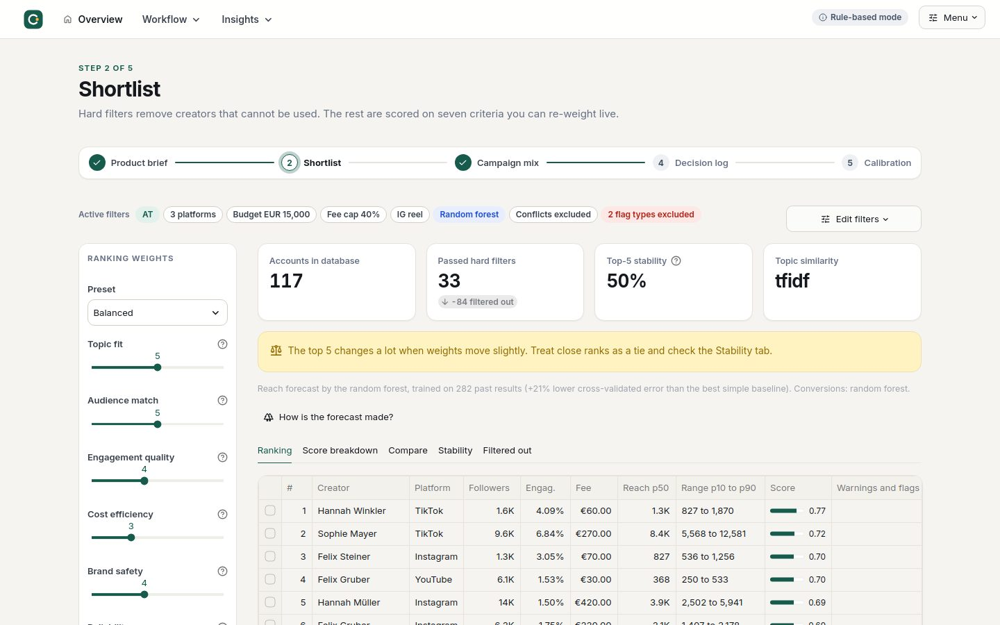

# Influencer Chooser

A decision-support tool for a marketing agency. Upload a product brief, and the app filters, scores and
ranks your partner influencers, builds the best campaign mix for a budget, shows the range of likely
outcomes, and learns from real campaign results.

**Principle: AI reads and explains, code decides.** An AI model (through OpenRouter) extracts the brief, researches the market,
explains rankings and plays devil's advocate. Every score, ranking, budget split and forecast is calculated
by deterministic Python from the database, so results are repeatable and auditable. Without an API key the
app still works in rule-based mode.

> The bundled data is **synthetic** (fictional people and brands, calibrated to published 2026 benchmarks).
> See [DATA_SOURCES.md](DATA_SOURCES.md) and [docs/DATA.md](docs/DATA.md).



Design system, layout patterns and responsive behaviour: [docs/DESIGN.md](docs/DESIGN.md).

## Quick start

```bash
python -m venv .venv && source .venv/bin/activate      # Windows: .venv\Scripts\activate
pip install -r requirements.txt
streamlit run app.py
```

Optional: add your OpenRouter key to enable the AI features. Either paste it into the header Menu (kept for the
browser session only), or copy `.streamlit/secrets.toml.example` to `.streamlit/secrets.toml`.

First steps in the app: **Product brief** → pick a sample brief → *Load sample brief* → *Analyze brief* →
**Shortlist** → **Campaign mix** → *Save decision*.

To test the upload path, upload `data/test_briefs/Product_Sheet_Kleinstern_Sleepy_Stars.pdf` and select the client brand
*Kleinstern* (enables the competitor check).

## Deploy free on Streamlit Community Cloud

1. Push this repository to GitHub (the folder `data/` with the SQLite file must be included).
2. On share.streamlit.io choose the repo and `app.py` as the main file.
3. Under *Advanced settings → Secrets* paste `OPENROUTER_API_KEY = "sk-or-v1-..."` (optional, see "AI through OpenRouter" below).
4. Deploy. The app copies `data/influencer_db.sqlite` to `data/working.sqlite` on first start.
   Cloud storage is ephemeral: saved decisions and logged results disappear when the app restarts.
   For permanent storage point `INFLUENCER_DB` at a persistent volume or move to Postgres.

## How it works

```
brief (pdf/docx/text) ──► AI profile (or rules) ──► hard filters ──► 7 weighted criteria ──► ranking
                                                         │                                      │
                                              reasons for every exclusion          stability + weight sensitivity
                                                                                                 ▼
 decision log ◄── memo / PDF ◄── risk review ◄── Monte Carlo ◄── optimal mix (integer programming)
      │
      └─► convert to campaign ─► log real results ─► calibration ─► better forecasts next time
```

| Page | What it does |
|---|---|
| Product brief | Reads PDF, Word, text or markdown. Builds an editable profile: category, goal, budget, countries, niches, tone, audience, restrictions. Optional web research. |
| Shortlist | Hard filters (availability, GDPR consent, country, budget share, safety flags, brand conflicts). Scores seven criteria, sliders re-rank live, top-5 stability, weight sensitivity, AI explanations. |
| Campaign mix | Maximises qualified reach (reach x audience match x topic fit), conversions or fit score under budget, creator count, concentration and platform constraints. Compares with "top scores until the budget is gone". Monte Carlo ranges, tornado chart, risk review, memo, PDF/HTML/Markdown/CSV export, save decision. |
| Explorer | Evidence behind the scores: follower and engagement trends, audience, rate cards, flags, content, campaign history. |
| Decision log | Saved decisions with weights, brief and scores (audit trail). Convert to a campaign, log real results. A demo helper simulates outcomes. |
| Calibration | Predicted vs actual reach, bias and interval coverage by audience size, the learned correction, and which known-in-advance features predict success. |
| Forecast model | Explains the **random forest** step by step: the data, one decision tree, the forest voting, an honest cross-validated test against simple baselines, feature importance, a per-creator explanation and a what-if tool. |
| Data sources | Where the numbers come from: monthly refresh (Apify import, Meta insights, persona redrafts), a confirmed and cost-capped Apify live run, Meta connections, and the import log. |

### The seven criteria (all 0 to 1)

| Criterion | Meaning |
|---|---|
| Topic fit | Text similarity between brief and the creator's bio and posts (percentile), plus niche overlap |
| Audience match | Share of the audience in the target gender, age range and countries |
| Engagement quality | Engagement rate adjusted for fake followers, relative to peers of the same platform and size |
| Cost efficiency | Expected views per euro for the chosen format, as a percentile |
| Brand safety | Falls with the severity of active safety flags |
| Reliability | Relationship score blended with on-time delivery and client ratings |
| Past performance | Client ratings in the same product category (neutral without history) |

### Forecasts: three methods, one honest test

The naive forecast (a creator's average views) is optimistic. The Shortlist page lets you choose how it is corrected:

| Method | What it does |
|---|---|
| Naive | Average views times the format factor, no correction. |
| Tier correction | Multiplies by the average bias found per audience size (shrunk when a tier has few results). |
| **Random forest** (default) | Two scikit-learn forests learned from every logged result: one predicts reach relative to the naive forecast, one predicts conversions per 1,000 reached. Inputs are facts known before the campaign (audience size, engagement vs peers, fake followers, recent follower jumps, rate, relationship, niche fit, the creator's earlier results). |

The forest is judged by 5-fold cross-validation grouped by campaign (no campaign is ever split between training and testing)
against simple baselines, and is only used where it cuts the error by at least 3%. Otherwise the app falls back and says so.
Ranges come from out-of-bag residuals, are widened for low-confidence data, and feed the optimizer and the Monte Carlo simulation.
Training is deterministic (fixed seed), takes about 7 seconds, and repeats automatically when new results are logged.
On the bundled data the reach forest has about 21% lower error than the tier correction and its 80% ranges contain 81% of outcomes.
The **Forecast model** page shows all of this interactively.

## What we changed after the agency interview

An influencer-agency practitioner described how creators are really chosen. Four points shaped the tool:

| What he said | What the tool does |
|---|---|
| "Below 2% engagement we don't work with them at all." Engagement = (likes, comments, saves, shares) / views of organic reels. | Hard filter **Minimum engagement** (default 2%) with a switch between **per view** (his definition, default) and **per follower**. On the Kleinstern brief 38 accounts pass per view and 22 per follower; @annabbzn (1.98% per follower) drops out. That is the "changed assumption" test case. |
| The creator must fit the brief as a person: a mother for a mothers' product, young for a "cringe" campaign. | Every creator has a free-text **persona** description (who they are: life stage, family, situation), versioned, redrafted by the AI from new posts and editable by the agency at any time. The brief gets a free-text **creator persona** requirement. The AI judges each creator *fits / does not fit / unclear* with an exact quote; **the code only excludes clear "does not fit" verdicts whose quote it can verify**, "unclear" stays in with a note, and a person can put anyone back in. Without AI, keyword rules handle parenthood requirements. |
| Brand agencies ask for statistics with proof (screenshots of link clicks, story clicks, reel reach, engagement). | **Stats pack** per creator (Explorer, and a bundle for the chosen mix): every number labelled *verified* (Meta API), *public* (Apify), *self-reported* (screenshot, attached), *estimate* or *missing*; self-reported numbers are cross-checked against public ones; missing numbers become a request list for the creator. Export as PDF, HTML or Markdown. |
| Agencies pitch each name together with a content idea. | The AI explanation now includes one **content angle** per creator (template in rule-based mode), shown on the shortlist and in the memo. |

### Data connections

| Source | What | When | Cost |
|---|---|---|---|
| **Apify** (`apify/instagram-profile-scraper`, `apify/instagram-reel-scraper`) | Public numbers: followers, bio, last 12 reels with plays, likes, comments, paid-partnership label | Monthly Apify schedule on the 1st (`0 6 1 * *`); the app imports the last finished run. Live runs on demand. | Import: free. Live: about USD 0.0026 per result, about USD 2.70 a month for 80 creators (free plan: USD 5). Live runs need a confirmation and have a hard cap (`maxTotalChargeUsd`). |
| **Meta Instagram API** (mocked) | Private numbers with the creator's permission: reach, views, saves, shares, story link clicks, audience | Monthly with the refresh; campaign posts at 1, 7 and 30 days, stories within 24 h | Free, but needs each creator to connect (Instagram Login) and Meta app review, so the demo uses a mock with the same JSON shape as the Graph API. `META_MODE=live` switches to the real client. |
| **Screenshots** | Same private numbers, typed in by the agency, with the file attached | When a creator does not connect | none |

Public scraping can never see reach, saves, story views or link clicks; that is why brand agencies ask for screenshots, and why the
Meta API (or the screenshot fallback) is part of the design. Campaign post insights pre-fill the result form in the Decision log, so the
learning loop needs less manual work (sales and the client rating still come from people).

Two **real public creators** (@valienchen, AT, and @annabbzn, DE) are in the database next to the synthetic ones, marked
`origin = real_public`. Only their public listing numbers (Modash, Oct 2026) are stored; views, rates and audience are labelled
as estimates until the first Apify run replaces them.

## AI through OpenRouter

All AI features use [OpenRouter](https://openrouter.ai) (an OpenAI-compatible API in front of many models). Without a key the app runs in
rule-based mode and everything still works.

1. Create a key at openrouter.ai/keys and add credits.
2. Streamlit Cloud: *App settings → Secrets*, then paste

   ```toml
   OPENROUTER_API_KEY = "sk-or-v1-..."
   # optional: any OpenRouter model slug that supports tool calling (openrouter.ai/models)
   OPENROUTER_MODEL = "anthropic/claude-sonnet-5.5"
   ```

   Locally: copy `.streamlit/secrets.toml.example` to `.streamlit/secrets.toml`, or set the same names as environment variables.
3. In the app, the header shows "AI active" and the Menu shows the model in use. With no secret set, the Menu offers key and model fields
   (kept for the browser session only).

How it calls the API: `POST https://openrouter.ai/api/v1/chat/completions` with a forced function call for structured answers
(brief profile, explanations, AI review) and `provider.require_parameters` so only providers that support tools are used. The optional market
research adds OpenRouter's `openrouter:web_search` server tool (billed by OpenRouter per search). If a model returns JSON as text instead of
a tool call it is still accepted. Failures (bad key, no credits, unknown model, rate limits) are shown in plain words and the app falls back to
rule-based text.

Some models have no provider that accepts a *forced* function choice (OpenRouter then answers 404 "No endpoints found that support the provided
'tool_choice' value"). The client therefore steps down automatically and remembers what worked for the model: forced function call, then
`tool_choice: "required"`, then `"auto"` with an instruction in the prompt, then plain JSON that is validated and parsed. The header Menu shows
which mode is in use. If no mode works, the error names the model, and the app falls back to rule-based text.

## AI usage and privacy

| Task | Done by |
|---|---|
| Extract the brief into a profile (forced tool call with enum-validated schema) | AI model, fallback: keyword rules |
| Persona descriptions (draft from bio and posts) and persona-fit verdicts with quotes | AI model, fallback: keyword rules; the exclusion itself is a code rule |
| Content angle per creator | AI model, fallback: template |
| Market research | AI model with OpenRouter's web search tool, optional |
| Explain ranked creators, review the mix, draft the memo | AI model, fallback: templates |
| Filters, scores, rankings, optimisation, simulation, calibration, **random forest forecasts** | Python only (the AI never produces numbers) |

The model receives only facts from the database and the brief, wrapped in tags and marked as data, not
instructions. Turn off *Use AI* in the header Menu to keep everything local. Check GDPR before loading real
creator data: lawful basis, retention (`consent_until`), no private contact data.

## Configuration

| Setting | How |
|---|---|
| API key | Streamlit secret or env var `OPENROUTER_API_KEY`, or the header Menu field (session only) |
| Model | `OPENROUTER_MODEL` secret or env var, or the header Menu field (default `anthropic/claude-sonnet-5.5`) |
| Database | `INFLUENCER_DB` (default `data/working.sqlite`) |
| Topic similarity | default TF-IDF; `EMBEDDING_BACKEND=sentence-transformers` after `pip install -r requirements-optional.txt` |
| Assumed conversion rates per goal, staleness and spike thresholds | `core/config.py` |
| Forest settings (trees, leaf size, seed, required gain) | `core/forest.py` |
| Engagement floor and basis | `MIN_ENGAGEMENT_PCT`, `ER_BASIS_DEFAULT` in `core/config.py` (also editable in the Shortlist filters) |
| Apify | `APIFY_TOKEN` (secret or env var, or the field on the Data sources page), `APIFY_PROFILE_TASK`, `APIFY_REEL_TASK` |
| Meta Instagram API | `META_MODE` = `mock` (default) or `live` |

## Repository

```
app.py                 router: grouped navigation (Workflow / Insights), logo, page config
pages/                 Home, Product brief, Shortlist, Campaign mix, Explorer, Decision log, Calibration, Forecast model, Data sources
core/                  engine (no Streamlit needed): scoring, optimizer, simulation, predict, forest, ai, report, db, ...
                       design system: theme.py (tokens and CSS), components.py (header, stepper, chips, empty states)
static/                bundled Inter font (OFL), logo and icon
data/                  influencer_db.sqlite, csv/, test_briefs/, ground_truth/planted_traps.csv
schema.sql             database schema and views
generate_dataset.py    deterministic synthetic data generator
tests/                 134 tests (core, forest, mocked AI, database, design system, headless pages, persona, Apify with fake HTTP,
                       Meta mock, stats pack) and 21 dataset checks
```

Run the tests: `pip install -r requirements-dev.txt && python -m pytest tests -q`
and the dataset checks: `python tests/validate_dataset.py`.

## Known limitations

* The OpenRouter integration is tested against a fake endpoint (request format, forced tool call, secrets handling, errors and retries). Verify it once with your real key: profile extraction, explanations and the optional web research.
* TF-IDF similarity is weaker than a multilingual embedding model; German and English are bridged through a niche keyword list.
* Conversion rates per goal are assumptions, not measurements. Replace them with your own.
* Audience overlap between creators is not modelled; the risk review only warns about same-niche concentration.
* SQLite on Streamlit Cloud is not persistent.
* Synthetic data: results show the method, not market truth.
* The Apify actor input fields (`usernames`, `username`, `resultsLimit`) follow the actors' documentation; check them once in the Apify
  console before the first live run. The Meta Instagram API is mocked.
* Persona descriptions of the synthetic creators are generated; real descriptions come from the AI redraft after an Apify import.
* Uploaded screenshots are stored under `data/uploads/`, which is not persistent on Streamlit Cloud.
